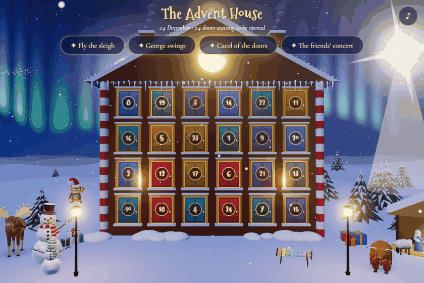

<div align="center">

# ✦ The Advent House ✦

### Twenty-four doors. One snowy night. A monkey with absolutely no respect for gravity.

[](https://chrisbrooksbank.github.io/adventcalendar/)




*A little December magic, built for your browser.*

[Step inside](https://chrisbrooksbank.github.io/adventcalendar/) · [Skip ahead to Christmas Eve](https://chrisbrooksbank.github.io/adventcalendar/?date=2026-12-24) · [Run it locally](#bring-the-house-home)

</div>

## The house at the end of the snowy lane

The windows glow. Snow drifts through the lamplight. Somewhere beneath an aurora, a moose is wearing fairy lights and a Highland cow is hiding behind his fringe. In front of you stands a house with twenty-four numbered doors.

You know the rules. One door a day.

Except this calendar has a few extracurricular activities. Father Christmas needs a delivery pilot. George the monkey has discovered that tinsel makes an excellent swinging rope. And the entire front of the house doubles as a musical instrument. Your quick festive visit may run slightly over schedule.

**The Advent House is an interactive 3D advent calendar**, with animated worlds, synthesised carols, games, and a cast of snowy friends. Open it in a modern browser with WebGL support; there is no account to create.

## In this December issue

[The attractions](#in-this-december-issue) · [First five minutes](#your-first-five-minutes) · [Controls](#the-pocket-sized-controls-guide) · [Local setup](#bring-the-house-home) · [Inside the workshop](#behind-the-fairy-lights) · [FAQ](#a-few-questions-from-the-doorstep)

| The attraction | Why you’ll linger |
| --- | --- |
| 🚪 **24 little worlds** | Each door reveals its own animated scene, caption, and tune, from the first snowflake to the stillness of *Silent Night*. |
| ✨ **A proper entrance** | Twenty-four different opening effects: hinges, theatre curtains, shattering fragments, melting panels, and more. Even the doors get a performance. |
| 🛷 **Midnight Delivery** | Fly over a snowy village and drop presents down chimneys. Chase combos, conserve your magic, and beat your best delivery run. |
| 🐒 **George Swings** | Hook fairy lights with tinsel, build momentum, and release at just the right moment. George supplies the enthusiasm; you supply the timing. |
| 🎹 **Carol of the Doors** | Follow a carol on the glowing doors, choose gentle or full notes, or switch to free play and make the house your instrument. |
| 🎶 **The Friends’ Concert** | Let the friends perform, tap the musicians for a reaction, and ask for another carol. The Huron Carol is always on the programme. |
| 🌌 **Winter atmosphere** | Falling snow, aurora, stars, bloom lighting, and clickable characters make waiting for December rather pleasant. |
| 💾 **A house that remembers** | Opened doors and game records are saved locally in your browser. Delivery and swinging challenges use a daily seed. |

## Your first five minutes

1. **[Visit the house](https://chrisbrooksbank.github.io/adventcalendar/).** Take a moment to watch the sky. The moose can wait.
2. **Click or tap a numbered door.** During December, doors up to today’s date can open. Come back tomorrow for the next one.
3. **Turn up the sound.** Interact with the page to allow browser audio; the **♪** button toggles sound.
4. **Meet the neighbours.** Click the friends outside. George is particularly keen to demonstrate something inadvisable.
5. **Try the four buttons above the house.** The calendar is only the beginning.

Visiting outside December? The house and its activities are still worth a trip. For a tour with every calendar door available, use the [Christmas Eve preview](https://chrisbrooksbank.github.io/adventcalendar/?date=2026-12-24). Preview door progress is saved separately from ordinary calendar progress.

### The pocket-sized controls guide

| Activity | Mouse / touch | Keyboard |
| --- | --- | --- |
| Explore the house | Click or tap doors and friends | **Esc** leaves a door scene |
| Fly the sleigh | Move the mouse or drag to steer; click, quick-tap, or tap with a second finger to drop a present | **Arrow keys / WASD** steer; **Space / Enter** drops |
| George Swings | Hold to hook; release to fling | Hold **Space / Enter / ↑**, then release |
| Carol of the Doors | Select a carol, then tap the lit doors; try **Free play** | Door rows, bottom to top: **ZXCVBN**, **ASDFGH**, **QWERTY**, **123456** |
| The Friends’ Concert | Tap the players; choose **Another carol** | **Esc** returns home |

Use the on-screen back buttons to return. In Carol of the Doors, **Esc** first returns to the song menu, then to the house.

## Bring the house home

You need **Node.js** and a modern browser with WebGL support. The static server uses Node’s built-in modules, and Three.js is included in the repository, so there are **no npm dependencies to install**.

```sh
git clone https://github.com/ChrisBrooksbank/adventcalendar.git
cd adventcalendar
npm start
```

Open **[http://localhost:8123](http://localhost:8123)**. Stop the server with **Ctrl+C**.

Prefer the direct route? `node server.js` does the same thing. The server also accepts a `PORT` environment variable. Serve the files over HTTP rather than opening `index.html` directly, so browser module imports work correctly.

### The editor’s time machine

Append these query strings to the live or local URL:

| Query | What it does |
| --- | --- |
| `?date=2026-12-24` | Pretend it’s Christmas Eve and make all calendar doors available. |
| `?date=2026-12-24&open=1` | Jump directly into the first door’s scene. Change `1` to any door from `1` to `24`. |
| `?allcarols` | Make all carols available to the musical modes. |
| `?game` | Start Midnight Delivery. |
| `?swing` | Start George Swings. |
| `?carol` | Open Carol of the Doors. |
| `?band` | Start The Friends’ Concert. |

## Behind the fairy lights

The scenery is built in JavaScript with **Three.js**, with custom shaders, particles, and bloom post-processing. The soundtrack comes from a **Web Audio synthesiser**: music-box tones, bells, effects, and shared reverb, without recorded samples to download. Native browser modules keep the project free of a build step.

```text
index.html          Page, styles, controls, and module import map
server.js           Small Node.js static server
js/
  main.js           House, calendar dates, saved progress, and mode switching
  days*.js          The 24 scene definitions and scene lifecycle
  doors.js          Door fragments, opening effects, and portal shader
  kit.js            Shared 3D scenery, geometry, and effects
  friends.js        The cast of characters
  game.js           Midnight Delivery
  swing.js          George Swings
  carol.js          Carol of the Doors
  band.js           The Friends’ Concert
  audio.js          Active synthesiser and sound engine
  songs.js          Song arrangements and validation
  tunes.js          Melodies and tune names
vendor/three/       Bundled Three.js and post-processing modules
sound-test.html     Sound audition page
docs/               README animation
```

<details>
<summary><strong>Workshop notes: checking changes</strong></summary>

Run the local server, then visit [`/?selftest`](http://localhost:8123/?selftest). The built-in browser checks exercise all 24 scenes, validate the songs, run the concert programme, and report captured errors in a `SELFTEST` result on the page.

For focused checks, these helpers are also available in the browser’s developer console after the app loads:

```js
window.__test()        // Render all 24 scenes at several animation times
window.__carolTest()   // Autoplay all 24 carols at both difficulties
window.__bandTest()    // Check note timing across the 25-song concert programme
window.__gameTest()    // Simulate a delivery run with the autopilot
window.__swingTest()   // Simulate swinging runs across several seeded forests
```

These synchronous helpers can take a moment. Use [`/sound-test.html`](http://localhost:8123/sound-test.html) to audition the sound engine, and manually check mouse and touch interaction when changing controls.

</details>

## A few questions from the doorstep

**Why won’t a door open?** The calendar follows your device’s local date. Ordinary doors unlock during December, up to the current day. Use the Christmas Eve preview if you’re exploring early.

**Where’s the sound?** Browsers require interaction before audio can start. Click or tap the page, check the **♪** toggle, and check your device volume.

**Will my progress follow me to another device?** Progress lives in this browser’s local storage. Another browser or device has its own progress; clearing site data removes the saved state.

**Does everything need an internet connection?** Three.js and the application code are bundled locally. The page requests its display fonts from Google Fonts and falls back to serif fonts if they’re unavailable.

**Can I help decorate?** Absolutely: [report a bug or suggest an idea](https://github.com/ChrisBrooksbank/adventcalendar/issues), or open a pull request. For visual changes, include a screenshot or short recording; for bugs, include your browser, device, and the URL you used so the same date and mode can be reproduced.

### Credits in the closing titles

Built with [Three.js](https://threejs.org/), bundled in `vendor/three/`. The lettering pairs **Mountains of Christmas** with **Cormorant Garamond**, served through Google Fonts. The house, games, and synthesised soundtrack live here in the repository—follow the file map above if you fancy peeking behind the scenery.

---

<div align="center">

*The snow is falling. The lights are on. George has already climbed something.*

**[Come on in. Christmas is behind the next door.](https://chrisbrooksbank.github.io/adventcalendar/)**

</div>
